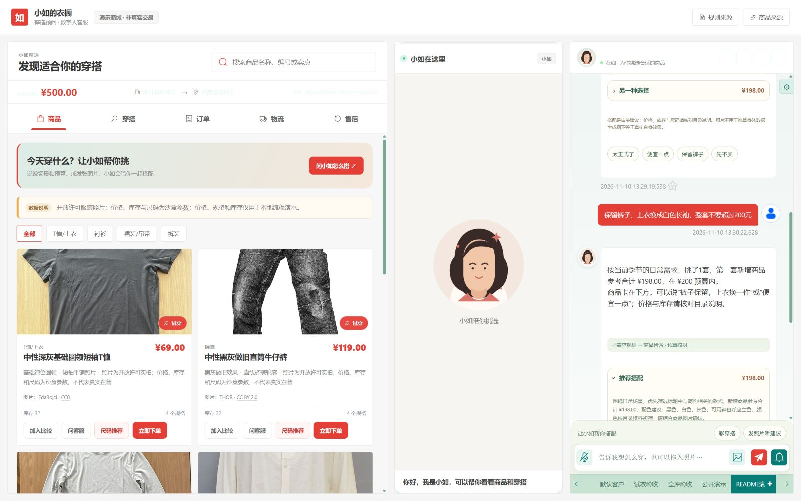
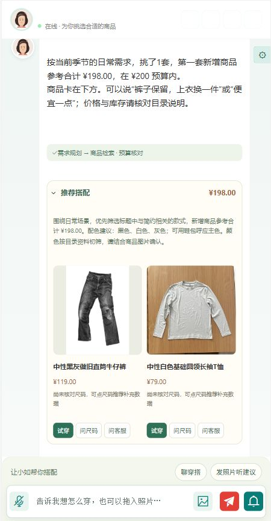
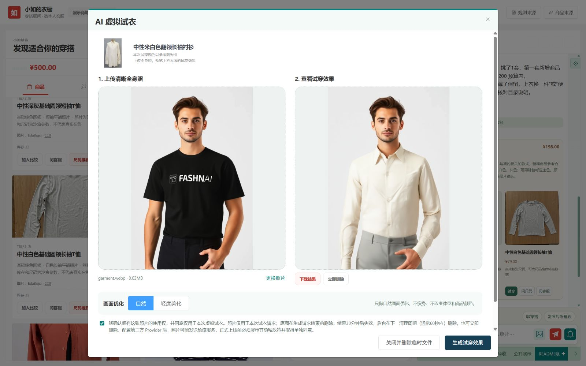

# 小如的衣橱

服装电商场景的数字人客服 Agent。用户通过文字、语音或照片与「小如」交流，Agent 收集需求、查询商品、提供搭配，再将推荐结果接到虚拟试衣和商城沙盒流程中。

项目基于 [Fay](https://github.com/xszyou/Fay) 扩展，保留 ASR、TTS、WebSocket、Live2D 与 FASHN 试衣链路。独立仓库使用新的 Git 历史，源码继续遵循上游 GPL-3.0 许可证。

## 功能

- **数字人客服**：文字与语音对话、播报、口型与动作；商品、尺码、订单、物流和政策工具共用客服入口。
- **语音与形象联动**：本机麦克风通过 ASR 转成文本，交给同一 Agent 处理；回复经 TTS 合成并播放，同时驱动 Live2D 口型与动作。语音基础能力沿用 Fay，业务工具与穿搭流程在此基础上扩展。
- **对话式穿搭**：询问场景、预算和偏好，观察用户上传的衣物或穿着照片；支持保留单品、替换一件和降低实际搭配总价。
- **真实服装试衣**：支持导入已有本机服装目录，并自带开放许可服装照片小样；推荐卡可继续调用 FASHN 试穿，支持上传、结果下载与删除。
- **电商沙盒**：购物车、500 元演示余额、订单、模拟物流和售后确认，支持大单转人工流程演示。

## 界面演示

**商城与数字人客服**



商城选衣、Live2D 数字人与客服对话共用一个工作台。截图为作者提供的本机运行界面，包含另行配置的角色和本机服装参考目录；新克隆需自行配置角色资源，默认使用开放许可服装小样与自制头像。

**照片穿搭入口**



穿搭顾问支持上传本人穿着照、已有衣服，或不传照片进行文字推荐。数字人客服聊天框也支持图片输入；看图、追问、商品推荐与方案调整共用 Agent 工具。此截图展示上传入口，未展示照片分析结果。

**本地 FASHN 试穿**



使用 FASHN 官方示例人物与开放许可服装，通过本地 GPU 生成并在界面显示试衣结果。结果为模型合成，仅供穿搭参考。

前两张为作者提供的本机运行截图；试衣示例使用开放许可服装与 FASHN 官方示例人物。角色模型文件和完整本机图库不随仓库分发，素材出处及说明见[截图素材来源](assets/screenshots/SOURCES.md)。

## Agent 如何工作

```text
文字 / 语音 / 照片
→ 输入与 ASR → Router / AgentController
→ 商品 / 订单 / 物流 / 政策 / 看图 / 搭配工具
→ 回复审核 → 对话卡片 / TTS / Live2D
                         ↓
                    FASHN 虚拟试衣
```

穿搭使用受约束的文本模型决策，每轮最多三个决策、两个工具；超时或无效输出回退规则流程。商品价格、候选、预算与访问权限由代码校验。订单物流使用有界状态流程，售后组合订单和政策查询；Reflection 是规则式审核，政策工具直接检索本地数据。项目没有完成模型微调，也不将所有请求描述为自由规划 ReAct。

## 启动

建议 Windows、Python 3.12。所有命令在仓库根目录的 PowerShell 中运行。启动脚本保留 `start_fay.ps1` 与 `FAY_*` 命名，兼容已有集成。

**已有可运行的 Python 环境**，可以直接复用，不必复制整个环境目录：

```powershell
.\scripts\initialize_local_config.ps1
.\scripts\start_fay.ps1 -PythonExe "YOUR_EXISTING_ENV\python.exe"
```

首次初始化只复制缺失的本机配置，不覆盖已有文件。启动前编辑 `system.conf`，填写实际文本模型地址、模型名、密钥和 ASR/TTS 服务配置；默认模板使用阿里语音服务，需要自己的凭据。已有环境也必须安装项目依赖。

**从新环境安装**：

```powershell
py -3.12 -m venv .venv
.\.venv\Scripts\python.exe -m pip install -r requirements.lock.txt
.\scripts\initialize_local_config.ps1
# 编辑 system.conf 后启动
.\scripts\start_fay.ps1
```

打开 `http://127.0.0.1:5000`。默认 `start_mode=common` 同时打开桌面窗口；只用网页时将 `system.conf` 改为 `start_mode=web`。这是本机工作台，默认仅监听回环地址，尚未提供公网用户账号体系。

### ASR、TTS 与语音使用

语音链路为「本机麦克风 → ASR → Agent / 工具 → 最终回复 → TTS → 播放 / Live2D」。ASR 负责语音识别，TTS 负责语音合成；它们与文本模型、看图模型、试衣模型分别配置。默认模板使用阿里云 ASR / TTS，需要开通相应服务并取得凭据，下载源码不会自动获得服务额度。

**配置默认阿里云方案**

先运行初始化脚本，再在本机 `system.conf` 现有的 `[key]` 节中修改下面这些项，保留文本模型等其他配置，不要另建重复的 `[key]` 节：

```ini
ASR_mode=ali
ali_nls_key_id=YOUR_ASR_ACCESS_KEY_ID
ali_nls_key_secret=YOUR_ASR_ACCESS_KEY_SECRET
ali_nls_app_key=YOUR_ASR_APP_KEY

tts_module=ali
ali_tss_key_id=YOUR_TTS_ACCESS_KEY_ID
ali_tss_key_secret=YOUR_TTS_ACCESS_KEY_SECRET
ali_tss_app_key=YOUR_TTS_APP_KEY
```

键名按现有实现保留为 **`ali_tss_*`**。识别与合成使用各自配置项；即使账号相同，也要分别填写对应服务的 AppKey。配置保存在本机，后续启动无需重复粘贴；`system.conf` 已被 Git 忽略。可对照 [配置模板](system.conf.example)，不要把真实密钥写入 README 或提交到 GitHub。

音色位于本机 `config.json` 的 `attribute.voice`，默认阿里云示例为 `zhistella`；切换 TTS 服务时应同时选择该服务支持的音色。初始化来源为 [config.example.json](config.example.json)。修改服务或凭据后重新启动工作台。

**录音与播放**

1. 在运行项目的电脑上打开 `http://127.0.0.1:5000`，选择当前聊天身份，再开启聊天框的麦克风开关。它保存 `source.record.enabled` 并将本机录音关联到当前会话，默认关闭。
2. 录音使用 PyAudio 和这台电脑的系统默认输入设备。请检查系统麦克风权限及默认输入设备；当前没有浏览器采音上传，远端手机或其他电脑不能通过这个按钮使用自己的麦克风。
3. `config.json` 中 `interact.playSound=true` 表示由运行项目的电脑播放，网页会跳过重复播音；默认模板采用此模式。设为 `false` 时，网页通过音频队列播放 TTS 结果，仍可驱动形象；浏览器拦截自动播放时先点击页面。该字段控制播放位置，不是 TTS 服务开关。
4. 配置 Live2D 后，播音会驱动口型和动作；有音素序列时优先使用，无音素数据时按音频时长驱动基础张闭嘴。语音服务可独立于角色资源使用。

**其他语音后端**

- 本地 ASR：设置 `ASR_mode=funasr`、`local_asr_ip=127.0.0.1`、`local_asr_port=10197`，并按 [本地 ASR 说明](asr/funasr/README.md)单独启动兼容服务。仓库附带服务加载 Paraformer，通过共享本机 WAV 路径识别；不是连接任意标准 FunASR 流式接口就能使用。该服务依赖版本与主项目不同，建议独立环境。
- 微软 TTS：设置 `tts_module=azure`，填写 `ms_tts_key` 和 `ms_tts_region`，并从 [音色列表](tts/tts_voice.py)选择对应显示名，如 `晓晓(azure)`。该实现也保留无 Azure Key 时的 `edge_tts` 网络合成分支，音色例为 `晓晓(edge)`；它仍需联网。
- 火山 TTS：设置 `tts_module=volcano`，填写 `volcano_tts_appid`、`volcano_tts_access_token`、`volcano_tts_cluster`、`volcano_tts_voice_type`。
- 本地 GPT-SoVITS：使用 `tts_module=gptsovits_v3`，在同一 `[key]` 节添加 `gptsovits_api_url`、`gptsovits_ref_audio_path`、`gptsovits_prompt_text`、`gptsovits_prompt_lang`、`gptsovits_text_lang`、`gptsovits_timeout`。默认接口为 `http://127.0.0.1:9880/tts`，语言默认 `zh`、超时默认 120 秒；参考音频路径须存在，外部模型服务需另行启动。配置读取与调用见 [实现](tts/gptsovits_v3.py)，模型与参考音频不在仓库内。

启动预检会检查默认阿里配置是否非空，不能替代真实识别 / 合成验收。没有识别文字时先检查录音设备与 ASR；有回复文字但无声音时检查 TTS 凭据、音色、播放位置、音量及浏览器自动播放限制。音频解码 / 转换报错还需检查 FFmpeg。先用文字完成商品咨询，再分别验证识别、合成和数字人动画，便于定位问题。

### 看图与试衣服务

看图默认使用本机 [Ollama](https://ollama.com/download/windows) 与 `qwen3-vl:2b-instruct`，无需视觉 API 密钥。安装 Ollama 后执行：

```powershell
.\scripts\setup_styling.ps1
```

启动器复用或启动 Ollama。看图按 CPU 配置运行，将 GPU 留给试衣；模型不可用时可先用文字推荐。

[FASHN VTON v1.5](https://github.com/fashn-AI/fashn-vton-1.5) 使用独立环境与权重。已有安装可设置实际路径：

```powershell
$env:FAY_FASHN_VTON_ROOT = "YOUR_FASHN_SOURCE"
$env:FAY_FASHN_VTON_PYTHON = "YOUR_FASHN_ENV\Scripts\python.exe"
$env:FAY_FASHN_VTON_WEIGHTS_DIR = "YOUR_FASHN_SOURCE\weights"
$env:FAY_TRYON_PROVIDER = "fashn_local"
.\scripts\start_fay.ps1 -PythonExe "YOUR_EXISTING_ENV\python.exe"
```

没有模型环境时，先按 FASHN 官方说明取得源码，再给 `scripts/setup_fashn_local.ps1` 传入 `-FashnRoot`、`-EnvironmentRoot`、`-WeightsRoot` 与 `-BasePython`。GPU 依赖和权重独立安装，不在仓库中。

应用会启动或复用 `127.0.0.1:7860` 的共享服务，推理请求顺序执行，退出工作台不关闭模型；全部不用时运行 `scripts/stop_shared_model.ps1`。`-NoLocalTryOn` 跳过新建模型，`-NoLocalStyling` 跳过 Ollama 自启动。也保留云端 FASHN Provider，可通过 `FAY_TRYON_PROVIDER=fashn` 和本机环境变量 `FASHN_API_KEY` 配置。

Live2D 接口继续保留。获许可的运行库放到 `gui/static/live2d/vendor/`，模型位于 `gui/static/live2d/model/<模型名>/<模型名>.model3.json`；用 `FAY_LIVE2D_MODEL` 选择模型，默认名为 `xiaoru_1`。未配置资源时显示自制头像，不影响客服工具和试衣入口。

## 服装样例与数据边界

本机已导入服装目录时，商城与 Agent 优先使用该目录；新克隆没有本机数据时，使用仓库自带的8张 Wikimedia Commons 真实服装照片，包括上衣、牛仔裤和连衣裙，许可为逐图核验的 CC0 或 CC BY。两种目录都接入「推荐 → 选衣 → FASHN 试穿」，不展示耳机、水杯等非试衣占位商品。

- [可分发服装小样](agent/data/products_public_fashion.json)：干净克隆时使用的服装图片与演示字段。
- [逐图来源与许可记录](agent/data/public_fashion_sources.json)：原文件页、作者、许可证、下载位置及裁剪/缩放处理。
- [随仓库分发的图片](gui/static/images/catalog/)：实际服装照片。

**图片是真实衣物照片，业务流程仍是沙盒。** 开放小样的价格、库存与尺码为演示参数；本机导入保留快照已有的参考价、SKU与尺码，不补造缺失规格，也不代表实时在售。余额、订单、物流与售后不连接真实商家后台，不发起支付、下单和退款。生成图不保证实物细节或真实合身。

CC0 图片允许复制、修改和再分发；CC BY 图片须保留作者与来源、许可链接，并注明改动。公开展示或复制小样时一并保留逐图记录，不将图片统一改标为 GPL。后续加入自己的商品时也应记录图片权利来源。

### 可选：导入已有本机服装目录

从原项目的本地快照导入可试穿服装，原目录只读、不做修改。在新项目根目录运行：

```powershell
& "YOUR_EXISTING_ENV\python.exe" scripts/import_local_fashion.py `
  --source-data "YOUR_EXISTING_PROJECT\agent\data"
```

源目录须包含 `products_youzan_public.json` 和 `store_profile.json`；可选读取已有 `tryon_references.json`。默认导入全部符合条件的服装，下载并解码校验照片，排除帽子、包等不支持的配饰；实际数量以脚本结果为准。先试小批可加 `--limit 40`，重复运行会复用已校验的 JPEG。脚本不遍历店铺网页，只读取快照中的图片地址。全量模式记录并跳过失败图片；限量模式尝试补足候选，数量不足时不覆盖原目录。

产物是新项目 `agent/data/` 中的三个本机 JSON，图片位于 `gui/static/images/catalog-local/`，原名、来源映射和缩略总览保存在 `cache_data/local-catalog-import/`。这些路径均被忽略，不随 GitHub 分发；重启工作台后优先读取导入目录。展示名自动去掉源店名，可重复传入 `--redact-term "YOUR_BRAND_TOKEN"` 去掉其他品牌词；改名不改变原图片的权利归属，本机参考图与公开 CC 小样分别保留来源记录。

## 验证与代码

```powershell
.\scripts\test_agent.ps1 -PythonExe "YOUR_EXISTING_ENV\python.exe"
.\scripts\demo_preflight.ps1 -PythonExe "YOUR_EXISTING_ENV\python.exe"
```

前端回归需要 Node.js；只跑后端可添加 `-SkipUi`。预检检查本机配置、依赖和端口。自动化测试覆盖 Agent、交易、穿搭、试衣接口、安全与界面交互；真实 GPU 生成、麦克风、扬声器及 Live2D 效果需要配置资源后单独体验。

- `agent/`：Controller、Router、工具、穿搭规划、Provider 与样例数据。
- `gui/`：商城、数字人、客服对话与 Web API。
- `scripts/`：初始化、启动、模型服务与验证脚本。
- `test/`：业务、界面和安全回归。

## 许可与发布

代码遵循 [GPL-3.0](LICENSE)，保留 [Fay 上游](https://github.com/xszyou/Fay) 来源及原有版权声明；更名和独立 Git 历史不改变这些义务。本项目不是 Fay 官方产品。

Live2D/Cubism 运行库、角色模型、贴图、动作、FASHN 与 Qwen 模型权重、云端语音和模型服务各有许可或服务条款，不由源码许可证统一授权。仓库不分发受限角色素材、私人照片或模型权重；请从官方渠道取得资源，并核对用途与再分发条件。Python 依赖也遵循各自许可证。

`.gitignore` 排除本机配置、密钥、数据库、记忆、日志、上传照片与生成结果。上传 GitHub 前仍需检查实际提交清单，保留 LICENSE 和图片许可记录，不提交旧开发仓库的历史凭据。GitHub 登录使用本机凭据管理器或 `gh auth login`，不把密码或 Token 写入仓库。
