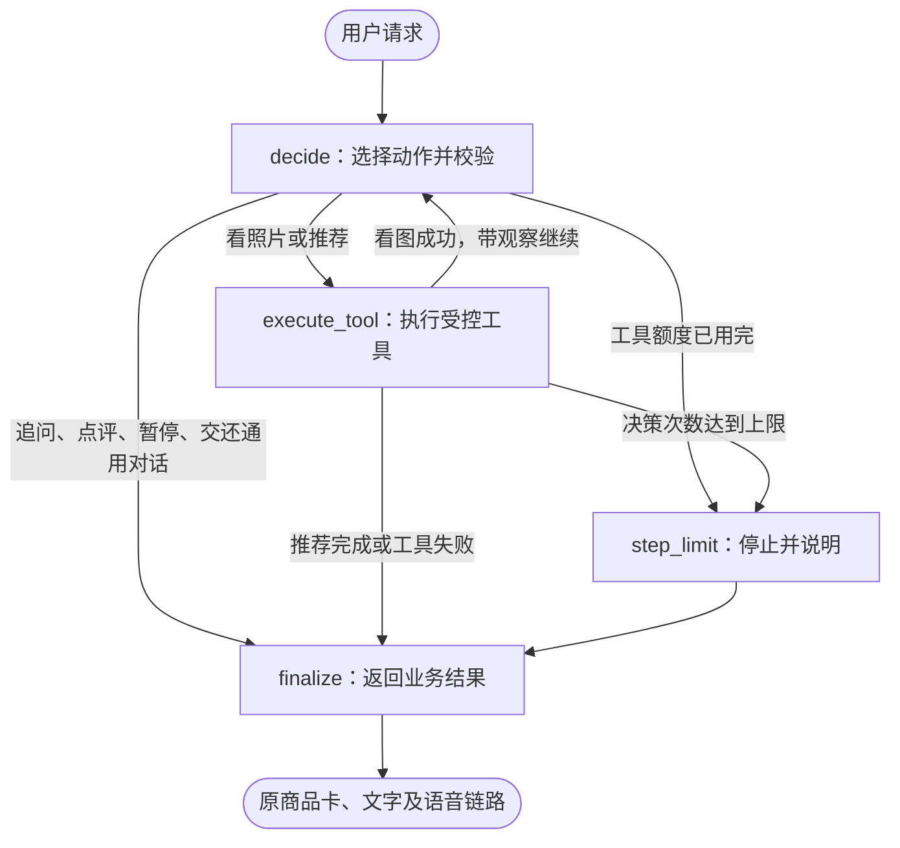

# LangGraph 穿搭 Agent：实际调用链与实现范围

更新日期：2026-11-11。此次迁移让数字人客服的穿搭主流程实际经过 LangGraph，不只是安装依赖或保留一段示例代码。

## 从用户的一句话看流程

用户说“帮我挑一套通勤衣服，预算300”，进入既有 Controller。Controller整理当前会话的需求，再调用 `StylingWorkflow.run()`，由编译后的图执行：



例如上传衣服照片后，实际节点轨迹是：

```text
decide → execute_tool → decide → execute_tool → finalize
         看图并核验归属           推荐商品
```

缺预算时是 `decide → finalize`，只返回追问；看图失败时是 `decide → execute_tool → finalize`，不会拿失败结果继续推荐。

## 四个节点各自负责什么

- `decide`：整理允许的动作，将脱敏后的上下文交给文本模型，验证动作、预算来源和条件更新。没有模型或模型失败时，在此节点使用原规则决策。
- `execute_tool`：只允许照片观察和搭配推荐两类动作。身份、附件ID和保留商品来自可信的服务端状态，不直接执行模型随意提交的参数。
- `step_limit`：业务步骤用完后结束，返回可理解的提示。
- `finalize`：转成原有 `StylingOutcome`，继续交给 Controller，保持商品卡、语音和数字人接口。

这四个节点通过 `StateGraph.add_node()` 注册，通过普通边和条件边连接，再由 `compile()`、`invoke()` 实际执行。代码见 [workflow.py](../agent/styling/workflow.py)；入口见 [Controller](../agent/controller.py)。

## 图状态与多轮记忆是两件事

图状态保存本次执行的需求、观察、动作、计数、工具结果及节点轨迹。每次 `run()` 都重新创建状态；同一个编译图也不会自动沿用其他用户上次的输入。

跨轮的预算、待补字段、当前方案和保留单品，继续由既有穿搭服务保存，并受原来的 owner 归属和 `turn_lock(owner)` 保护。LangGraph没有替代这些业务规则。

本版不启用 checkpointer，不保存整张图到数据库，也没有断点恢复。图内会处理身份、附件ID和身体条件，所以执行使用独立 `contextvars.Context`，关闭该作用域内的 LangSmith tracing，并显式清空调用 callbacks，避免继承父级追踪器导出完整状态；调用结束后不改变外层追踪上下文。对外元数据只增加引擎名及节点名；文本模型仍只接收 `public_context()` 筛选的内容。

## 怎样防止反复调用

- 业务决策最多3次，工具执行最多2次；两个上限分别计数。
- 图调度的 `recursion_limit=12` 是另一个兜底，不等于允许12次模型请求。它还包含工具、结束等节点。
- 看图成功后清除待看图状态，不重复消费同一附件。
- 模型超时或JSON无效后，本次执行关闭模型，后续节点使用规则，不持续重试模型。
- 工具失败立即结束；本图没有安装自动重试策略，避免重复调用工具。
- 保留裤子、上衣降价、排除旧款与实际总价上限继续沿用原有代码校验。

## 怎么证明运行的是 LangGraph

在项目根目录执行，不需要模型密钥或GPU：

```powershell
python scripts/inspect_styling_graph.py --format json
python scripts/inspect_styling_graph.py --format mermaid
python -m unittest test.test_styling_langgraph
```

检查脚本直接读取实际编译图的节点和边，没有调用图片服务，也没有使用另写的示意图冒充业务图。[styling-graph.mmd](styling-graph.mmd)由该脚本导出。

新的回归测试会验证实际调用 `CompiledStateGraph.invoke`、观察返回模型后再推荐、失败停止、规则降级、步骤上限，以及重复/并发调用的状态隔离。卡片元数据增加：

```json
{
  "workflow_engine": "langgraph",
  "workflow_nodes": ["decide", "execute_tool", "finalize"]
}
```

`FAY_STYLING_PLANNER=rule`只关闭文本模型决策，仍执行同一张 LangGraph 图。因此“运行了图”和“本次使用了真实LLM”要分别判断；后者可看 `decision_mode`、`planner_fallback` 和审核记录。

完整回归与规则场景命令：

```powershell
.\scripts\test_agent.ps1 -PythonExe "YOUR_EXISTING_ENV\python.exe"
python scripts/evaluate_styling_agent.py --mode rule
```

这些测试覆盖流程与约束，包含mock和固定fixture，不能当作真实模型识别准确率、真实试衣质量或公网并发能力。

## 迁移范围

迁移的是客服穿搭的追问、看图、推荐主路径。商品比较、显式暂停等快捷分支仍可由 Controller 直接处理；普通商品、订单、物流和售后也继续使用既有确定性业务流程。

本次没有把试衣生成塞进决策图：它仍由推荐卡按钮进入原试衣接口。ASR、TTS、Live2D、上传校验、隐私清理、商城沙盒和GPU推理服务继续沿用。

政策工具仍是本地JSON关键词检索，不因使用LangGraph而变成向量RAG；本次没有加入模型微调、多Agent协作、持久检查点、人工中断恢复或可靠任务队列。

## 面试时怎样讲

可以说：“我基于Fay扩展服装电商数字人客服，使用LangGraph编排穿搭Agent，将模型决策、受控工具、条件路由和结束处理组织成图；同时用代码保留预算、商品和用户归属校验，并通过回归测试验证迁移后的行为。”

如果问为什么迁移：原先手写循环已经能完成任务；这次把状态和流转明确到图节点，便于检查执行路径，也为后续复杂分支留下扩展位置。框架本身不会提升审美、自动防越权或提供持久恢复，不能把这些收益混为一谈。

截至本次迁移，能据此说明的是穿搭业务的实际 LangGraph 使用经验。继承文件中原来未被主流程调用的图定义，不作为此次迁移的运行证据。
